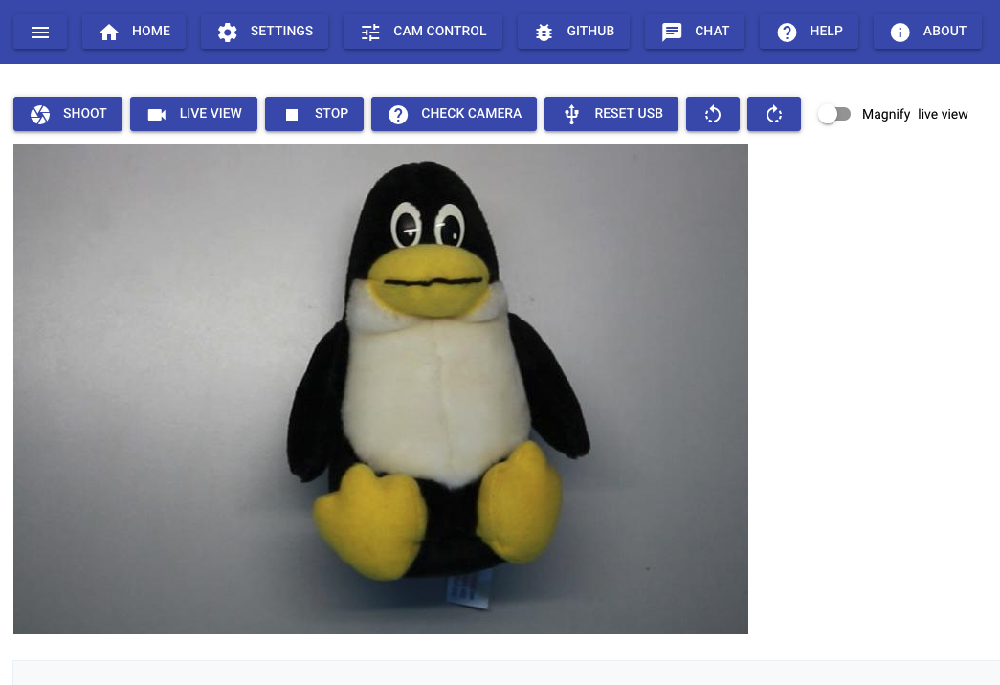

# scan2wiki
Scan from cams and scanners to Document Management System and SemanticMediaWiki

[](https://pypi.org/project/scan2wiki/)
[](https://github.com/WolfgangFahl/scan2wiki/actions/workflows/build.yml)
[](https://pypi.python.org/pypi/scan2wiki/)
[](https://github.com/WolfgangFahl/scan2wiki/issues)
[](https://github.com/WolfgangFahl/scan2wiki/issues/?q=is%3Aissue+is%3Aclosed)
[](https://WolfgangFahl.github.io/scan2wiki/)
[](https://www.apache.org/licenses/LICENSE-2.0)

[](http://www.bitplan.com)


## Scan Interface


## CLI Usage
### scan2wiki
Semantified Document Management System webserver

```bash
scan2wiki -h
```
```
usage: scan2wiki [-h] [-a] [-d] [--debugLocalPath DEBUGLOCALPATH]
                 [--debugPort DEBUGPORT] [--debugRemotePath DEBUGREMOTEPATH]
                 [--debugServer DEBUGSERVER] [-f] [-q] [-v] [-V]
                 [--apache APACHE] [-c] [-l] [-i INPUT] [-rol] [--host HOST]
                 [--port PORT] [-s] [-rp ROOT_PATH] [-wc WEBCAMS]
                 [--web-host WEB_HOST]
```
Start the webserver on the default port 8334:
```bash
scan2wiki -s
```
Serve with webcams configured as name-url pairs:
```bash
scan2wiki -s --webcams cam1=http://cam1.example/mjpeg
```

### cam2web
The webcam emulator serving a gphoto2 camera moved to its own project, see
[cam2web](https://github.com/WolfgangFahl/cam2web).

## Links
* [Python](https://www.python.org/)
* [pywikibot](https://pypi.org/project/pywikibot/)
* [scan2wiki on pypi](https://pypi.org/project/scan2wiki)

## Documentation
[Wiki](http://wiki.bitplan.com/index.php/scan2wiki)
